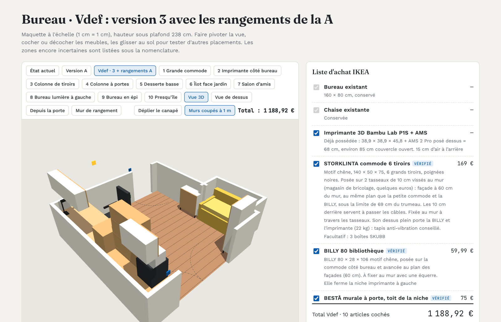
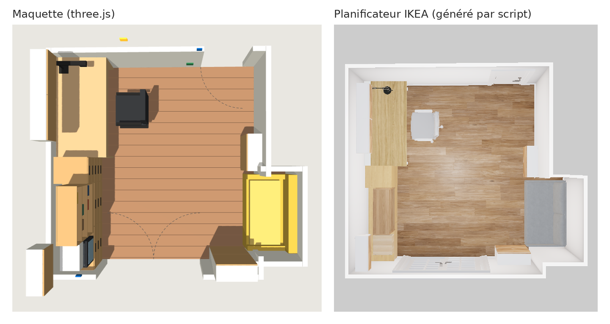

# ikea-room-to-cart

Modéliser une pièce en 3D à l'échelle, la retrouver dans le planificateur IKEA, puis commander en un clic.



J'ai écrit ces outils pour aménager mon bureau avec des meubles IKEA. Le planificateur en ligne d'IKEA montre bien le résultat, mais tout s'y saisit à la souris : les murs, les ouvertures, chaque meuble, et tout est à refaire dès qu'on compare deux idées. J'ai donc inversé la démarche. Je travaille dans une maquette 3D légère où chaque meuble porte ses références IKEA, et des scripts reconstruisent ensuite la pièce et les meubles dans le planificateur, vérifient le résultat, puis préparent le panier.

## Le parcours

1. **Modéliser.** La pièce et les meubles tiennent dans un seul fichier HTML (three.js) : vue 3D et vue de dessus, glisser-déposer des meubles au sol, liste d'achat et total qui suivent la sélection.
2. **Ajuster.** Plusieurs versions cohabitent dans la même maquette. Chacune garde ses positions, ses meubles cochés et son total, ce qui permet de comparer deux implantations en un clic.
3. **Visualiser dans le planificateur IKEA.** Une commande contrôle d'abord les références (teintes, conditionnement, compléments oubliés), construit la pièce exacte dans le planificateur, y pose chaque meuble par sa référence, vérifie le design à 2 cm près et le partage.
4. **Commander.** Un lien remplit le panier ikea.fr avec les bonnes références et quantités, prix du jour relus. La commande se valide ensuite sur ikea.fr, comme d'habitude.

Le détail de chaque étape et les pièges rencontrés sont dans [docs/parcours.md](docs/parcours.md).



## Exemple : mon bureau

[projets/bureau](projets/bureau/) contient le premier projet mené de bout en bout : une pièce de 3,30 × 3,40 m qui n'est pas d'équerre, avec un renfoncement, une porte-fenêtre, un canapé-lit et une imprimante 3D à loger. Sept implantations ont été comparées avant d'en retenir une, et la version finale, en chêne naturel, représente 13 références et 1 188,92 € sur ikea.fr.

## Utilisation

Il faut Node.js 24 (voir `.nvmrc`) et, pour le planificateur, Chromium via Playwright.

```bash
npm install
npx playwright install chromium   # uniquement pour le planificateur

# Toute la chaîne : références, planificateur, vérification, panier
npm run ikea -- projets/bureau/maquette.html V --sortie out/V

# Contrôle des références seul (teintes, prix, compléments oubliés)
npm run refs -- projets/bureau/maquette.html V

# Liste d'achat et lien panier seuls
npm run panier -- projets/bureau/maquette.html V --html out/V.html

# Données JSON du projet (pièce, articles, versions), sans réseau
npm run extraire -- projets/bureau/maquette.html
```

La chaîne complète prend moins d'une minute sur le bureau. Elle écrit dans le dossier de sortie un `resume.md` (lien du design, lien panier, total, écarts), la vue de dessus du planificateur et un plan de vérification en SVG. Son code de sortie vaut 0 quand tout est conforme.

Pour un nouveau projet, copier une maquette existante et remplacer la pièce et la liste des meubles : le format est décrit dans [docs/format-maquette.md](docs/format-maquette.md).

## Organisation

```
docs/        parcours, format de la maquette, fonctionnement du planificateur IKEA
outils/      scripts Node
  ikea.js               chaîne complète, de la maquette au panier
  lint-refs.js          contrôle des références et des teintes
  verifier.js           vérification d'un design partagé, sans navigateur
  liste-achat.js        liste d'achat et lien panier ikea.fr
  maquette-vers-ikea.js pose des meubles dans le planificateur
  piece/                construction de la pièce dans le room-builder IKEA
  lib/                  API du planificateur, catalogue, teintes, vérification, Chromium
  extraire-donnees.js   maquette → données JSON
  fiche-saisie.js       cotes d'une version (coins des meubles, distances aux murs)
projets/     un dossier par pièce aménagée
test/        tests (node:test)
```

## Comment ça marche

Le planificateur IKEA n'a pas d'API publique. Les scripts utilisent celles de l'application web elle-même : un jeton invité, comme un visiteur sans compte, pour créer les designs et y poser les meubles, et l'interface du room-builder, pilotée dans un Chromium headless, pour tracer les murs au centimètre. Aucun compte IKEA n'est utilisé et rien n'est commandé automatiquement. Les notes techniques sont dans [docs/planificateur-ikea.md](docs/planificateur-ikea.md).

Ces interfaces ne sont pas documentées et peuvent changer sans préavis : les scripts ont été écrits et vérifiés sur ikea.com/fr en octobre 2026.

## Licence

Code sous licence [MIT](LICENSE). Les photos, plans et images du dossier `projets/` ne sont pas couverts par cette licence.

Projet personnel, sans lien avec IKEA. IKEA et les noms de produits cités sont des marques d'Inter IKEA Systems B.V.
