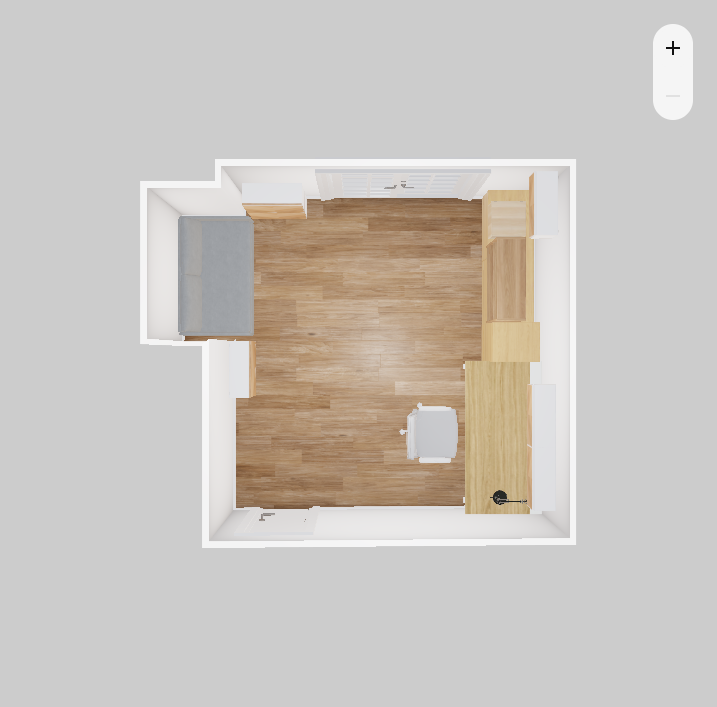

# Bureau

Premier projet mené avec l'outil, en octobre 2026 : transformer une petite chambre en bureau, avec un coin pour mon imprimante 3D et un canapé-lit pour les invités, uniquement avec des meubles IKEA.

|                                  |                                                                                                                                                                                    |
| -------------------------------- | ---------------------------------------------------------------------------------------------------------------------------------------------------------------------------------- |
| Maquette                         | [maquette.html](maquette.html), à ouvrir dans un navigateur (état actuel, A, Vdef et les onze pistes étudiées depuis A)                                                            |
| Version retenue                  | Vdef, 1 188,92 € sur ikea.fr : [design dans le planificateur](https://www.ikea.com/fr/fr/home-design/share/81455d46-9f21-4b21-b11f-2f787b414f12/), [paniers et détail](paniers.md) |
| Pièce vide dans le planificateur | [design partagé](https://www.ikea.com/fr/fr/home-design/share/ccdada6e-6384-427f-a805-94f6fa957805/), vérifié à 1 cm                                                               |
| Données                          | [donnees/](donnees/), régénérées par `npm run extraire -- projets/bureau/maquette.html`                                                                                            |
| Sources                          | [plan dessiné](sources/plan-dessine.jpg), [photo d'inspiration](sources/inspiration.jpg)                                                                                           |
| Archives                         | [maquette v18](archives/maquette-v18.html) avec les versions B à G, liens des anciennes versions dans [donnees/liens-ikea.json](donnees/liens-ikea.json)                           |

## La pièce

Cotes intérieures en cm, vue de dessus orientée comme le plan dessiné : porte en haut, porte-fenêtre en bas, renfoncement à droite.

- Plafond à 238.
- Mur de la porte : 329,5, soit 235 de mur, une porte d'environ 74,5 ouvrant vers l'intérieur, puis 20 jusqu'à l'angle.
- Côté droit : 343 au total, dont un renfoncement de 138 de large et de 56 à 67,5 de profondeur (le fond est légèrement en biais).
- Mur de la porte-fenêtre : 318, soit 69, une porte-fenêtre à deux vantaux de 164,5 encadrement compris, puis 84,5.
- Mur gauche : 340. La pièce n'est pas d'équerre, et la maquette comme le planificateur gardent cet écart de 3 cm.
- Une seule prise connue, à 20 cm à gauche de la porte.

Je conserve mon bureau 160 × 80, ma chaise et mon imprimante Bambu Lab P1S avec son AMS posé dessus : 68 cm de haut, environ 85 cm couvercle ouvert, et 15 cm d'air à laisser derrière.

## Contraintes

- Style : chêne naturel, comme mon bureau ; un bas profond et fermé, à tiroirs, et des cases moins profondes au-dessus ; quincaillerie noire.
- Ni KALLAX, ni gamme cuisine (METOD, MAXIMERA, VOXTORP, KARLBY), ni sur-mesure : la gamme cuisine n'existe pas dans le planificateur classique, et le sur-mesure ne se commande pas en un clic.
- Canapé-lit de 138 cm hors tout au maximum pour entrer dans le renfoncement. Chez IKEA France, cela laisse HAMMARN (128 cm) et FRIDHULT (126 cm, couchage 119 × 202).
- Imprimante : une vraie niche aérée, avec un rangement propre pour les bobines.

## Les versions

Sept implantations ont été modélisées et envoyées dans le planificateur, toutes vérifiées à 2 cm :

| Version | Idée                                                                                        | Total ikea.fr |
| ------- | ------------------------------------------------------------------------------------------- | ------------- |
| A       | Bureau côté porte, meuble bas à tiroirs et bibliothèque entre le bureau et la porte-fenêtre | 1 098,92 €    |
| B       | Bureau côté porte-fenêtre, niche imprimante côté porte                                      | 1 144,92 €    |
| C       | A avec une niche imprimante sur le plateau, bibliothèque déplacée sur le mur de la porte    | 1 264,90 €    |
| D       | C avec l'imprimante au bout, côté porte-fenêtre, pour l'aération                            | 1 264,90 €    |
| E       | D sans la bibliothèque du mur de la porte, jugée trop chargée                               | 1 144,92 €    |
| F       | Bureau côté porte-fenêtre, bobines dans des EKET vitrés                                     | 1 209,89 €    |
| G       | E allégée, avec le canapé HAMMARN                                                           | 820,89 €      |

J'ai retenu A : la lumière vient de côté, sans reflet sur l'écran, et la bibliothèque posée sur le meuble bas fonctionne bien. Il lui manquait une place pour l'imprimante, et l'espace entre le bureau et la porte-fenêtre restait sous-exploité. Les liens des versions B à G sont conservés dans [donnees/liens-ikea.json](donnees/liens-ikea.json).

Pour combler ces manques, j'ai ensuite repris A sous la forme de onze pistes, de la grande commode à la presqu'île en passant par le bureau en épi. Elles restent consultables dans la maquette, boutons 1 à 11.

## Version finale (Vdef)

Vdef reprend la piste 3, une colonne de tiroirs à côté du bureau, et garde les rangements de A autour du canapé, passés en chêne naturel comme le bureau. Deux Vdef précédentes ont été abandonnées : une colonne PAX en chêne blanchi, qui ne s'accordait pas avec le bureau, puis une colonne BILLY/OXBERG dont la profondeur rompait l'alignement des façades.

- Mur gauche, 340 cm occupés au centimètre : le bureau (160), une STORKLINTA 40 × 120 à cinq tiroirs, puis une commode STORKLINTA 140 × 50 à six tiroirs jusqu'à la porte-fenêtre.
- Les deux commodes sont posées sur des tasseaux de 10 cm vissés au mur : leurs façades sont au même plan, à 60 cm du mur, sous la limite de 69 cm imposée par le trumeau de la fenêtre, et les câbles passent derrière.
- Sur la grande commode, une BILLY 80 côté bureau, avancée au même plan, puis la niche de l'imprimante sur le dessus plein : 60 × 89 cm sous une BESTÅ murale, pour 85 cm nécessaires couvercle ouvert, éclairée par une réglette à détecteur. Les tablettes ne portent que 20 kg, l'imprimante en pèse 22.
- Au-dessus du bureau, deux BESTÅ murales de 38 cm de haut à portes HEDEVIKEN plaqué chêne, fixées à 1,50 m comme les cubes EKET de A, et la lampe FORSÅ.
- Autour du canapé FRIDHULT, comme dans A : un chevet BESTÅ côté porte et une colonne de deux BESTÅ côté fenêtre, sur pieds STUBBARP pour laisser passer l'aspirateur robot, et un spot à pince pour lire.
- Tout part de la seule prise, côté porte : rallonges et bloc multiprise sous le bureau.

Total : 1 188,92 € pour 13 références, identique dans la maquette et sur ikea.fr. La chaîne place les 14 meubles à 2 cm près dans le planificateur. Les BESTÅ y gardent un caisson blanc, comme chez IKEA, qui ne vend pas de caisson BESTÅ en chêne.

## Ce que j'en retiens

- Un plan dessiné à la main avec toutes les cotes vaut mieux que n'importe quel nombre de photos.
- Comparer sept implantations n'aurait pas été réaliste dans le planificateur à la souris ; dans la maquette, une version de plus coûte quelques minutes.
- Le panier généré a révélé des articles oubliés dans les premières listes (charnières, câbles d'alimentation, quincaillerie vendue par deux).
- Le planificateur n'a pas tous les coloris en 3D : il sert à valider l'implantation et les volumes. Les teintes se contrôlent sur les références, avant de construire (`lint-refs.js`).

La commande n'est pas encore passée.
